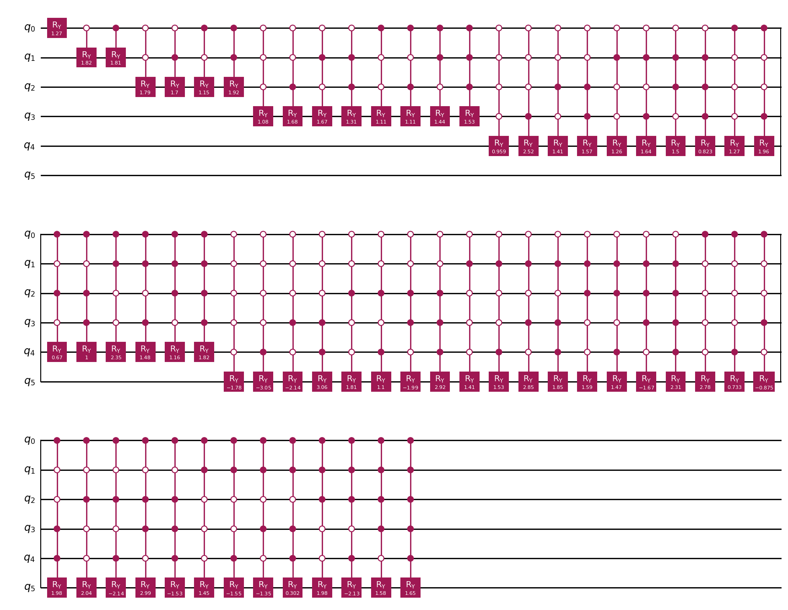
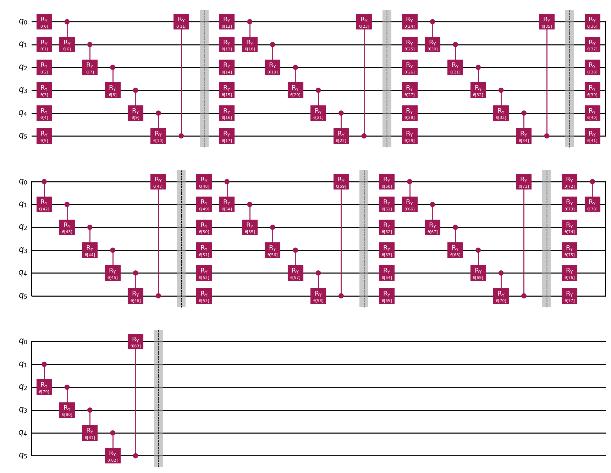

# Variational Quantum State Preparation and Amplitude Encoding

Python/Qiskit implementations of **exact and approximate quantum state preparation** from classical vectors. The project investigates parameterized quantum circuits trained to reproduce a target state using several global and local objectives.

## Methods

- Exact state preparation with a divide-and-conquer circuit.
- Variational circuits with tunable rotation gates and entangling operations.
- Global state-fidelity loss, sparse-fidelity experiments, reduced-density-matrix (RDM) losses, and reverse-circuit/local training.
- L-BFGS-B and Adam optimization plus scripts for scaling and threshold benchmarks.

The global infidelity loss is

$$
\mathcal L(\theta)=1-|\langle\psi_{\mathrm{target}}|\psi(\theta)\rangle|^2.
$$

## Circuit examples

**Exact state-preparation circuit**, exported from [Final Revision.ipynb](Final%20Revision.ipynb):

**Parameterized approximate circuit**, exported from the same notebook:

## Recorded optimization result

One existing experiment under [data_output/test0/vector_0/](data_output/test0/vector_0/) records a **final loss of 0.00024767535879937074**, with **160 iterations** and **30 trainable parameters** (according to its saved metadata). This is a single run, not an aggregate or independently replicated benchmark. Details are in [results/recorded_run.md](results/recorded_run.md).

## Repository structure

| File or folder | Purpose |
| --- | --- |
| [Final Revision.ipynb](Final%20Revision.ipynb) | Explanatory notebook with saved outputs |
| [circuits/](circuits/) | Exact, approximate, and reverse circuit implementations |
| [training_global/](training_global/) | Global/sparse objectives |
| [training_local/](training_local/) | Local RDM objectives |
| [training_reverse/](training_reverse/) | Reverse-training experiments |
| [benchmark_scaling.py](benchmark_scaling.py) | Scaling experiments |
| [benchmark_threshold.py](benchmark_threshold.py) | Threshold experiments |
| [data_output/](data_output/) | Some recorded numerical outputs and histories |

## How to run

Requires Python, NumPy, SciPy, Matplotlib, Qiskit, and Qiskit Aer. The explanatory notebook additionally imports the legacy `qiskit_textbook` package, so its cells may need adaptation in a current Qiskit environment.

Execute from the repository root so that local module imports resolve. Select hyperparameters and seeds in [configs/settings.py](configs/settings.py). Results shown above are taken from existing committed outputs; **no new optimization run was performed** to generate this README.

## Related projects

[FFT-based homogenization](https://github.com/thanhnd034/fft-homogenization) · [Fourier Neural Operators](https://github.com/thanhnd034/FNO-homogenization-model) · [PD–SPH fluid–structure interaction](https://github.com/thanhnd034/PD-SPH-FSI-model)
